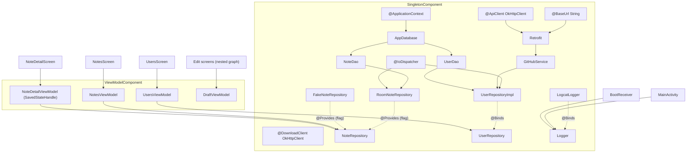

# Hilt Practice - Notes + GitHub users

Small Android app (Kotlin, Jetpack Compose) used to practise dependency injection with Hilt.
It has a notes feature (Room) and a GitHub users list (Retrofit, cached in Room).

## Setup

1. In Android Studio create an **Empty Activity** project named `HiltPractice`, package `com.example.hiltpractice`
   (this creates the Gradle wrapper).
2. Copy these files over the generated ones: `gradle/libs.versions.toml`, root `build.gradle.kts`,
   `app/build.gradle.kts`, `app/src/**` (including `AndroidManifest.xml`).
3. Delete the template's `ui/theme` folder and the generated `MainActivity` if Android Studio complains about duplicates.
4. Sync Gradle.

Versions: Hilt 2.57.1, KSP, Room 2.7.2, Retrofit 2.11, OkHttp 4.12.

## Run

```
./gradlew installDebug                    # real notes repository
./gradlew installDebug -PuseFake=true     # fake notes repository (Q23)
./gradlew test                            # JVM tests (no emulator)
./gradlew connectedDebugAndroidTest       # instrumented tests (emulator or device)
```

## Structure

```
app/src/main/java/com/example/hiltpractice
  App.kt, MainActivity.kt
  core/        Logger, LogcatLogger, FileLogger
  data/        entities, DAOs, AppDatabase, GitHubService, repositories
  di/          Qualifiers, NetworkModule, DatabaseModule, DispatcherModule, LoggingModule, RepositoryModule
  ui/          ViewModels, screens, navigation
  receiver/    BootReceiver
  experiments/ Chain (Q9), Scopes (Q16)
q01-manual-di-basics/   plain Kotlin files for Q1
extras/manual-di/       AppContainer reference for Q3/Q4
NOTES.md                answers and observations per question
```

## Component and dependency diagram



## Tests

JVM (`app/src/test`, 10 tests, hand-made fakes, no Hilt):
- `UserRepositoryTest` (3): stores users, network failure keeps cache, HTTP error; uses a `StandardTestDispatcher` injected as `@IoDispatcher`.
- `NotesViewModelTest` (2), `NoteDetailViewModelTest` (2, with `SavedStateHandle`), `UsersViewModelTest` (3).

Instrumented (`app/src/androidTest`, 5 tests):
- `HiltSmokeTest` (1): `@HiltAndroidTest` + `hiltRule.inject()`.
- `NotesUiTest` (2): in-memory database via `TestDatabaseModule`.
- `UsersMockWebServerTest` (2): `MockNetworkModule` replaces `NetworkModule` with `MockWebServer`.

## Question -> files -> suggested commit message

| Q | Files | Commit |
|---|---|---|
| 1 | `q01-manual-di-basics/` | `q01: hardcar vs car` |
| 3-4 | `extras/manual-di/` (branch `manual-di`) | `q03: app container` |
| 6 | gradle files | `q06: hilt gradle setup` |
| 7 | `App.kt`, manifest | `q07: hilt android app` |
| 8 | `MainActivity.kt`, `core/Logger.kt` | `q08: field injection` |
| 9 | `experiments/Chain.kt` | `q09: injection chain` |
| 11 | `di/LoggingModule.kt` | `q11: binds logger` |
| 12 | `di/NetworkModule.kt` | `q12: network module` |
| 13 | `di/DatabaseModule.kt` | `q13: database module` |
| 14 | `di/Qualifiers.kt` | `q14: qualifiers` |
| 15 | `di/DispatcherModule.kt`, `UserRepositoryTest.kt` | `q15: dispatcher and base url` |
| 16 | `experiments/Scopes.kt` | `q16: scope experiment` |
| 21 | whole app (branch `hilt`) | `q21: migrate to hilt` |
| 22 | `NoteDetailViewModel`, test | `q22: savedstatehandle` |
| 23 | `RepositoryModule.kt`, `FakeNoteRepository` | `q23: fake repository switch` |
| 24 | `receiver/BootReceiver.kt` | `q24: broadcast receiver` |
| 25 | `ui/AppNav.kt`, `DraftViewModel` | `q25: shared viewmodel` |
| 27 | `app/src/test` | `q27: jvm tests` |
| 28 | `HiltTestRunner`, `HiltSmokeTest` | `q28: hilt android test` |
| 29 | `TestDatabaseModule`, `NotesUiTest` | `q29: replaced database module` |
| 30 | `MockNetworkModule`, `UsersMockWebServerTest`, README | `q30: capstone` |

Questions 2, 5, 10, 17, 20, 26 are theoretical (answers in `NOTES.md`). Question 19 (multi-module) is not included: do it on your own branch.
